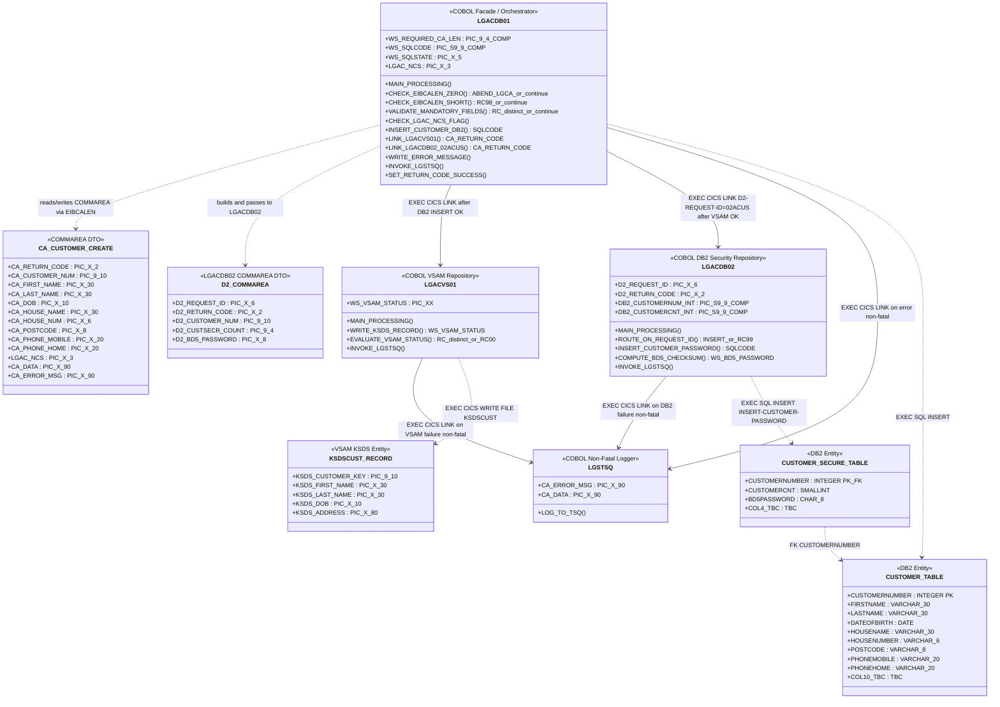

# Customer Record Creation Service

## C3 — Summary

This C3 Component diagram models the internal logical architecture of the Customer Record Creation Service (SVC-001) — a COBOL/CICS modular monolith on IBM Z that implements the complete Customer Record Creation bounded context (Feature F-01). The service is anchored by LGACDB01, which acts as the single-entry-point Orchestration Facade. Inbound requests arrive via EXEC CICS LINK from calling application programs, SOA adapters, or BMS terminal screens, all carrying a structured COMMAREA payload. Internally, the service is decomposed into ten logical components: a COMMAREA Interface Guard (zero-length ABEND / short-COMMAREA RC=98), a Mandatory Field Validator (name, address, DOB), the Orchestration Facade itself (LGACDB01 — LGAC-NCS flag evaluation and sequential LINK chain), a DB2 CUSTOMER Repository (10-column INSERT with SQLCODE handling), a VSAM KSDSCUST Repository (LGACVS01 — KSDS WRITE with key synchronisation), a Customer Security Record Repository (LGACDB02 — request code 02ACUS, 4-column CUSTOMER_SECURE INSERT), a BD5 Checksum Engine (default password computation), a Transaction Boundary Coordinator (CICS UoW syncpoint/rollback across heterogeneous stores), a Non-Fatal Error Logger (LGSTSQ — TSQ write without CA-RETURN-CODE override), and a COMMAREA Return Code Manager (authoritative RC propagation). External dependencies are DB2 CUSTOMER table, DB2 CUSTOMER_SECURE table, KSDSCUST VSAM KSDS, CICS Temporary Storage Queue, and the CICS Transaction Server runtime.

## C3 — Insights

- LGACDB01 implements a strict Facade / Single Entry-Point pattern: all callers — whether CICS programs, SOA adapters, or BMS screens — must invoke customer creation exclusively through this one program via COMMAREA/LINKAGE, eliminating direct coupling to persistence sub-programs.
- The COMMAREA Interface Guard enforces a two-tier length contract: a zero-length COMMAREA triggers an immediate ABEND LGCA (NODUMP) with no data-store operations attempted, while a short-but-non-zero COMMAREA returns RC=98 and halts processing — both guards fire before any DB2, VSAM, or CICS LINK operation.
- Mandatory field validation (name, address, date of birth) is a distinct logical component that executes after the COMMAREA length guards pass. It returns a dedicated error code (not 00, 98, or 99) and prevents any downstream persistence operation, enforcing a clean fail-fast contract.
- The orchestration sequence is strictly ordered and non-reversible: DB2 CUSTOMER INSERT must succeed before CICS LINK to LGACVS01 is issued, and LGACVS01 must succeed before CICS LINK to LGACDB02 is issued. Reversing this order violates the atomicity contract.
- The Transaction Boundary Coordinator manages a CICS Unit of Work spanning two heterogeneous stores (DB2 and VSAM). A VSAM write failure after a successful DB2 INSERT requires a rollback or compensating DELETE to prevent an orphaned CUSTOMER row — the exact mechanism must be confirmed with stakeholders and formally documented.
- The BD5 Checksum Engine is encapsulated entirely within LGACDB02, enforcing security data segregation: the checksum algorithm, input value, and output length are isolated from LGACDB01 and the VSAM path, limiting sensitive credential computation to the dedicated security sub-program.
- LGACDB02 implements a request-code dispatch pattern: it only performs the CUSTOMER_SECURE INSERT when D2-REQUEST-ID equals '02ACUS'; any other request code results in RC=99 and immediate CICS RETURN with no INSERT attempted — this provides a safe extension point for future operations.
- The Non-Fatal Error Logger (LGSTSQ) implements the Non-Fatal Observer pattern across all three persistence programs. A pre-invocation COMMAREA guard (EIBCALEN 0–90 partial copy) is applied before each LGSTSQ LINK call. LGSTSQ failures are silently absorbed and the primary CA-RETURN-CODE is never overridden by logging side-effects.
- The COMMAREA Return Code Manager ensures RC=00 is set only when all three persistence operations succeed. Distinct return codes are defined for each failure mode: duplicate-key, unexpected SQLCODE, DB2 unavailability, VSAM failure, CUSTOMER_SECURE failure, validation errors, and COMMAREA structural errors — providing unambiguous diagnostic signals to all callers.
- Security data segregation is enforced architecturally: LGACDB02 is the only program with write authority to DB2 CUSTOMER_SECURE, and LGACDB01 never directly handles sensitive credential fields. RACF controls at the program and DB2 table level reinforce this separation at the infrastructure layer.

## C3 — Interfaces

### COMMAREA Inbound Interface (LGACDB01 Entry Point) (CICS COMMAREA / EXEC CICS LINK)
The sole inbound interface for the Customer Record Creation Service. All callers — CICS application programs, SOA adapters, and BMS screen programs — must invoke LGACDB01 exclusively via EXEC CICS LINK with a structured COMMAREA payload containing customer personal details and control fields. No online or screen-based direct invocation path exists.

- EXEC CICS LINK PROGRAM('LGACDB01') COMMAREA(customer-creation-commarea) — create new customer record
- COMMAREA field: CA-RETURN-CODE — output return code (00=success, 98=short COMMAREA, 99=unrecognised request, distinct codes for each failure mode)
- COMMAREA field: CA-CUSTOMER-NUM — output DB2-assigned customer number on success
- COMMAREA field: CA-FIRST-NAME, CA-LAST-NAME — mandatory input personal detail fields
- COMMAREA field: CA-ADDRESS — mandatory input address field
- COMMAREA field: CA-DATE-OF-BIRTH — mandatory input date of birth field
- COMMAREA field: LGAC-NCS — control flag; must equal ON to trigger DB2 CUSTOMER INSERT path

### DB2 CUSTOMER INSERT Interface (Embedded SQL / CICS-DB2 Attachment Facility)
Embedded SQL interface used by the DB2 CUSTOMER Repository component (within LGACDB01) to insert a new customer row into the DB2 CUSTOMER table. Executes when LGAC-NCS equals ON and all validation guards have passed. SQLCODE and SQLSTATE are captured after every INSERT attempt.

- EXEC SQL INSERT INTO CUSTOMER (CUSTOMERNUMBER, FIRSTNAME, LASTNAME, DATEOFBIRTH, HOUSENAME, HOUSENUMBER, POSTCODE, PHONEMOBILE, PHONEHOME, <10th-column-TBC>) VALUES (...)
- SQLCODE=0 — success; continue to LGACVS01 LINK
- SQLCODE=duplicate-key — set distinct duplicate-key CA-RETURN-CODE; CICS RETURN
- SQLCODE=unexpected — set distinct unexpected-SQLCODE CA-RETURN-CODE; CICS RETURN
- DB2 subsystem unavailable — set distinct DB2-unavailability CA-RETURN-CODE; CICS RETURN

### CICS LINK Interface to LGACVS01 (VSAM Write) (EXEC CICS LINK / COMMAREA)
CICS LINK interface used by the Orchestration Facade to invoke LGACVS01 after a successful DB2 CUSTOMER INSERT. Passes customer record data and VSAM key (customer number) via COMMAREA. LGACVS01 returns write outcome to LGACDB01 via the same COMMAREA.

- EXEC CICS LINK PROGRAM('LGACVS01') COMMAREA(vsam-write-commarea) — write customer record to KSDSCUST
- COMMAREA field: VSAM-CUSTOMER-KEY — customer number matching DB2-assigned key
- COMMAREA field: VSAM-CUSTOMER-RECORD — full customer record payload for KSDS write
- COMMAREA field: VSAM-RETURN-CODE — output write outcome (success/failure) returned to LGACDB01
- On VSAM failure: set distinct VSAM-failure CA-RETURN-CODE in LGACDB01; do NOT issue CICS LINK to LGACDB02

### CICS LINK Interface to LGACDB02 (Security Record Creation) (EXEC CICS LINK / COMMAREA)
CICS LINK interface used by the Orchestration Facade to invoke LGACDB02 with request code 02ACUS after a successful VSAM write. Passes customer number, security count, and BD5 checksum data via COMMAREA. LGACDB02 returns insertion outcome to LGACDB01.

- EXEC CICS LINK PROGRAM('LGACDB02') COMMAREA(security-record-commarea) — insert CUSTOMER_SECURE record
- COMMAREA field: D2-REQUEST-ID = '02ACUS' — mandatory request code for CUSTOMER_SECURE INSERT path
- COMMAREA field: D2-CUSTOMER-NUM — customer number mapped to DB2-CUSTOMERNUM-INT
- COMMAREA field: D2-CUSTSECR-COUNT — security count mapped to DB2-CUSTOMERCNT-INT
- COMMAREA field: D2-RETURN-CODE — output insertion outcome returned to LGACDB01
- D2-REQUEST-ID != '02ACUS': LGACDB02 sets D2-RETURN-CODE='99' and CICS RETURN with no INSERT

### DB2 CUSTOMER_SECURE INSERT Interface (Embedded SQL / CICS-DB2 Attachment Facility)
Embedded SQL interface used by the Customer Security Record Repository (LGACDB02) to insert the BD5 checksum security record into DB2 CUSTOMER_SECURE. Executes only when D2-REQUEST-ID equals 02ACUS and BD5 checksum computation succeeds.

- EXEC SQL INSERT INTO CUSTOMER_SECURE (CUSTOMERNUM, CUSTOMERCNT, <security-password-col>, <4th-col-TBC>) VALUES (...) — insert all 4 columns
- SQLCODE=0 — success; set D2-RETURN-CODE to success value; CICS RETURN
- SQLCODE!=0 — set distinct CUSTOMER_SECURE-failure D2-RETURN-CODE; invoke LGSTSQ; CICS RETURN
- BD5 checksum computation failure — surface as distinct error condition before INSERT is attempted

### VSAM KSDSCUST WRITE Interface (EXEC CICS FILE CONTROL / VSAM KSDS)
CICS File Control interface used by the VSAM KSDSCUST Repository (LGACVS01) to write a new customer record to the KSDSCUST KSDS dataset. The VSAM record key must match the DB2-assigned customer number to maintain cross-store referential integrity.

- EXEC CICS WRITE FILE('KSDSCUST') FROM(customer-vsam-record) RIDFLD(customer-number-key) — write new KSDS record
- RESP=NORMAL — success; return success status to LGACDB01 via COMMAREA
- RESP=DUPREC — duplicate record; return distinct duplicate-record error status
- RESP=NOTOPEN / RESP=DISABLED — VSAM unavailable; return distinct subsystem-error status
- RESP=other — unexpected error; invoke LGSTSQ; return distinct unexpected-error status

### LGSTSQ Non-Fatal Logging Interface (EXEC CICS LINK / COMMAREA / CICS TSQ)
CICS LINK interface used by LGACDB01, LGACVS01, and LGACDB02 to invoke the LGSTSQ error logging program on any persistence failure. A pre-invocation COMMAREA guard copies DFHCOMMAREA(1:EIBCALEN) to CA-DATA when EIBCALEN is between 1 and 90. LGSTSQ failures are silently absorbed and the primary CA-RETURN-CODE is never overridden.

- Pre-invocation guard: IF EIBCALEN > 0 AND EIBCALEN < 91 THEN MOVE DFHCOMMAREA(1:EIBCALEN) TO CA-DATA
- EXEC CICS LINK PROGRAM('LGSTSQ') COMMAREA(CA-ERROR-MSG) — log error/audit entry to CICS TSQ
- Post-invocation: verify CA-RETURN-CODE is unchanged after LGSTSQ LINK returns
- LGSTSQ failure: silently absorbed; EXEC CICS RETURN proceeds with original CA-RETURN-CODE
- EIBCALEN >= 91: skip partial-copy step; invoke LGSTSQ without DFHCOMMAREA partial copy

### CICS TSQ Write Interface (LGSTSQ → TSQ) (EXEC CICS WRITEQ TS / CICS Temporary Storage)
CICS Temporary Storage Queue write interface used by LGSTSQ to persist error and audit log entries. Provides a non-intrusive, non-transactional logging sink that does not affect the primary CICS Unit of Work outcome.

- EXEC CICS WRITEQ TS QUEUE(lgstsq-queue-name) FROM(error-log-record) — write error/audit entry
- Queue entry contains: program name, error message, SQLCODE/VSAM status, timestamp
- TSQ write failure: silently absorbed by LGSTSQ; no impact on primary transaction


## C3 — Relationships

- ? -> ?: Orchestration Facade delegates COMMAREA length validation to COMMAREA Interface Guard on every inbound invocation before any business logic executes
- ? -> ?: COMMAREA Interface Guard passes control to Mandatory Field Validator only after both length guards (zero-length ABEND and short-COMMAREA RC=98) are satisfied
- ? -> ?: Mandatory Field Validator returns validation outcome (pass or distinct error code) to Orchestration Facade; facade issues CICS RETURN immediately on any validation failure
- ? -> ?: Orchestration Facade triggers DB2 CUSTOMER INSERT via DB2 CUSTOMER Repository when LGAC-NCS equals ON and all validation guards have passed
- ? -> ?: Orchestration Facade issues EXEC CICS LINK to LGACVS01 (VSAM KSDSCUST Repository) only after DB2 CUSTOMER INSERT succeeds (SQLCODE=0)
- ? -> ?: Orchestration Facade issues EXEC CICS LINK to LGACDB02 (Customer Security Record Repository) with D2-REQUEST-ID=02ACUS only after LGACVS01 returns success
- ? -> ?: Customer Security Record Repository invokes BD5 Checksum Engine to compute the default security password before executing the CUSTOMER_SECURE INSERT
- ? -> ?: Orchestration Facade coordinates with Transaction Boundary Coordinator to manage the CICS Unit of Work — committing on full success or triggering rollback/compensating-delete on any partial failure
- ? -> ?: Orchestration Facade manages CA-RETURN-CODE via Return Code Manager throughout the lifecycle, setting RC=00 only on full three-store success
- ? -> ?: DB2 CUSTOMER Repository invokes Non-Fatal Error Logger (LGSTSQ) on any DB2 INSERT failure without overriding the primary CA-RETURN-CODE
- ? -> ?: VSAM KSDSCUST Repository invokes Non-Fatal Error Logger (LGSTSQ) on any VSAM write failure without overriding the primary CA-RETURN-CODE
- ? -> ?: Customer Security Record Repository invokes Non-Fatal Error Logger (LGSTSQ) on any CUSTOMER_SECURE INSERT failure without overriding the primary CA-RETURN-CODE

## C3 — External dependencies

- DB2 CUSTOMER Table: Primary relational store for customer personal details. Written by DB2 CUSTOMER Repository (LGACDB01) as the first persistence step in the customer creation orchestration.
- DB2 CUSTOMER_SECURE Table: Segregated relational store for customer security credentials including BD5 checksum default password. Written exclusively by Customer Security Record Repository (LGACDB02).
- KSDSCUST VSAM KSDS: Key-sequenced dataset providing legacy and high-performance indexed access to customer records. Written by VSAM KSDSCUST Repository (LGACVS01) with key matching DB2 customer number.
- CICS Temporary Storage Queue: Non-fatal error and audit log sink. Written to by LGSTSQ (Non-Fatal Error Logger) on persistence failures across all three persistence programs.
- CICS Transaction Server: Transaction runtime managing program lifecycle, COMMAREA passing, CICS LINK dispatch, syncpoint/rollback, CICS-DB2 attachment facility, and VSAM File Control for all service components.
- Calling Application Program: Any CICS/COBOL program that invokes LGACDB01 via EXEC CICS LINK with a structured COMMAREA to create a new customer record. Receives the authoritative CA-RETURN-CODE as the persistence outcome.
- SOA Integration Layer: Bridges external web-service consumers to internal CICS LINK invocations of LGACDB01. Translates external service request formats into COMMAREA-based invocations.
- BMS / SSMAP Screen Layer: Interactive terminal screen layer that maps BMS fields to COMMAREA and invokes LGACDB01 for screen-driven customer creation flows initiated by terminal users.

## C3 — Diagram

```mermaid
flowchart TD
    %% External Actors
    TerminalUser["👤 Terminal User\n(CICS 3270 Operator)"]
    CallingApp["🖥️ Calling Application Program\n(CICS/COBOL or SOA Adapter)"]
    SOALayer["🔗 SOA Integration Layer\n(SOAVCII / SOAIPM1)"]
    BMSScreen["🖥️ BMS / SSMAP Screen Layer\n(3270 Terminal Interface)"]

    %% External Data Stores
    DB2Customer[("🗄️ DB2 CUSTOMER Table\n(DB2 for z/OS)")]
    DB2CustomerSecure[("🗄️ DB2 CUSTOMER_SECURE Table\n(DB2 for z/OS)")]
    KSDSCust[("📁 KSDSCUST VSAM KSDS\n(VSAM / CICS File Control)")]
    CICSTSQ[/"📨 CICS Temporary Storage Queue\n(CICS TSQ)"/]
    CICSRuntime["⚙️ CICS Transaction Server\n(IBM CICS TS)"]

    %% Service Boundary
    subgraph SVC001["Customer Record Creation Service (SVC-001)"]
        direction TD

        CommareaGuard["🛡️ COMMAREA Interface Guard\n(COBOL / EIBCALEN)\nValidates COMMAREA length;\nABEND on zero-length,\nRC=98 on short COMMAREA"]

        InputValidator["✅ Mandatory Field Validator\n(COBOL / LGACDB01)\nValidates name, address, DOB;\nreturns distinct error code\non missing/malformed fields"]

        OrchestrationFacade["🎯 Customer Creation Orchestration Facade\n(COBOL / LGACDB01)\nSingle entry-point; evaluates LGAC-NCS flag;\nsequences DB2 INSERT → LGACVS01 → LGACDB02;\nmanages transaction lifecycle"]

        DB2CustomerRepo["💾 DB2 CUSTOMER Repository\n(COBOL / Embedded SQL / LGACDB01)\nEXEC SQL INSERT INTO CUSTOMER\n(10 columns); handles duplicate-key,\nunexpected SQLCODE, DB2 unavailability"]

        VSAMRepository["💾 VSAM KSDSCUST Repository\n(COBOL / CICS File Control / LGACVS01)\nWrites KSDS record to KSDSCUST;\nkey matches DB2 customer number;\nreturns write outcome to facade"]

        SecurityRecordRepo["💾 Customer Security Record Repository\n(COBOL / Embedded SQL / LGACDB02)\nRequest code 02ACUS; inserts 4 columns\ninto CUSTOMER_SECURE;\nRC=99 for unrecognised request codes"]

        BD5ChecksumEngine["🔐 BD5 Checksum Engine\n(COBOL / LGACDB02)\nComputes BD5 checksum default\nsecurity password before\nCUSTOMER_SECURE INSERT"]

        TransactionCoordinator["🔄 Transaction Boundary Coordinator\n(CICS Syncpoint / COBOL)\nManages UoW across DB2 + VSAM;\napplies rollback/compensating-delete\non partial failure"]

        ErrorLogger["📋 Non-Fatal Error Logger — LGSTSQ\n(COBOL / CICS LINK)\nLogs persistence failures to TSQ;\npre-invocation COMMAREA guard;\nnever overrides CA-RETURN-CODE"]

        ReturnCodeManager["📤 COMMAREA Return Code Manager\n(COBOL / LGACDB01)\nMaintains CA-RETURN-CODE;\nRC=00 only on full success;\ndistinct codes for each failure type"]
    end

    %% External → Service
    TerminalUser -->|"Initiates via 3270 terminal"| BMSScreen
    BMSScreen -->|"EXEC CICS LINK / COMMAREA"| OrchestrationFacade
    CallingApp -->|"EXEC CICS LINK / COMMAREA"| OrchestrationFacade
    SOALayer -->|"EXEC CICS LINK / COMMAREA"| OrchestrationFacade

    %% Internal flow
    OrchestrationFacade -->|"Delegates length validation"| CommareaGuard
    CommareaGuard -->|"Passes after length guard"| InputValidator
    InputValidator -->|"Returns validation outcome"| OrchestrationFacade
    OrchestrationFacade -->|"DB2 INSERT when LGAC-NCS=ON"| DB2CustomerRepo
    OrchestrationFacade -->|"CICS LINK after DB2 success"| VSAMRepository
    OrchestrationFacade -->|"CICS LINK with 02ACUS after VSAM success"| SecurityRecordRepo
    SecurityRecordRepo -->|"Compute BD5 checksum"| BD5ChecksumEngine
    OrchestrationFacade -->|"Coordinate UoW commit/rollback"| TransactionCoordinator
    OrchestrationFacade -->|"Set/propagate CA-RETURN-CODE"| ReturnCodeManager
    DB2CustomerRepo -->|"Log DB2 failure non-fatally"| ErrorLogger
    VSAMRepository -->|"Log VSAM failure non-fatally"| ErrorLogger
    SecurityRecordRepo -->|"Log CUSTOMER_SECURE failure non-fatally"| ErrorLogger

    %% Internal → External data stores
    DB2CustomerRepo -->|"INSERT new customer row"| DB2Customer
    VSAMRepository -->|"WRITE KSDS record"| KSDSCust
    SecurityRecordRepo -->|"INSERT security record"| DB2CustomerSecure
    ErrorLogger -->|"WRITEQ TS error/audit entry"| CICSTSQ

    %% Infrastructure
    OrchestrationFacade -.->|"Executes within CICS transaction"| CICSRuntime
    TransactionCoordinator -.->|"SYNCPOINT / ROLLBACK"| CICSRuntime
```



## C4 — Classes

- LGACDB01
- LGACVS01
- LGACDB02
- LGSTSQ

## C4 — Summary

This C4 Code diagram details the internal code structure of the Customer Record Creation Service (SVC-001) — a COBOL/CICS modular monolith on IBM Z. The diagram focuses on the four programs that carry real design decisions: LGACDB01 (Facade/Orchestrator), LGACVS01 (VSAM Repository), LGACDB02 (DB2 Security Repository), and LGSTSQ (Non-Fatal Logger). It shows their key working-storage fields, method-equivalent paragraphs, COMMAREA DTOs, DB2 table entities, VSAM KSDS record layout, and all CICS LINK / SQL dependencies. The guard sequence in LGACDB01 (zero-COMMAREA ABEND → short-COMMAREA RC=98 → field-validation → LGAC-NCS flag → DB2 INSERT → LINK LGACVS01 → LINK LGACDB02 → RC='00') is the central design decision captured at this level. The non-fatal LGSTSQ observer pattern and the BD5-checksum security segregation in LGACDB02 are the two other critical code-level concerns highlighted.

## C4 — Insights

- LGACDB01 implements a strict sequential guard chain (BR-LGACDB01-001/002/003): EIBCALEN=0 triggers ABEND LGCA with NODUMP; EIBCALEN < WS-REQUIRED-CA-LEN returns RC=98 immediately; mandatory-field failure returns a distinct non-00/98/99 code — all three guards prevent any DB2 or VSAM write from occurring on bad input.
- The orchestration sequence in LGACDB01 is order-critical and non-reversible: DB2 CUSTOMER INSERT must succeed before CICS LINK to LGACVS01 is issued, and LGACVS01 must succeed before CICS LINK to LGACDB02 is issued. Reversing this order violates the Chain-of-Responsibility contract (P-02).
- LGACDB02 uses D2-REQUEST-ID as a discriminator (request-code router pattern): '02ACUS' routes to INSERT-CUSTOMER-PASSWORD; any unrecognised code sets D2-RETURN-CODE='99' and returns immediately with no INSERT — this is the sole routing decision in the program.
- LGSTSQ implements a non-fatal observer pattern (P-05): before invocation, each calling program applies a pre-guard (IF EIBCALEN > 0 AND < 91 THEN MOVE DFHCOMMAREA(1:EIBCALEN) TO CA-DATA). Critically, CA-RETURN-CODE set before the LGSTSQ LINK must be identical after it returns — LGSTSQ failure is silently absorbed.
- The BD5 checksum computation (COMPUTE-BD5-CHECKSUM in LGACDB02) is a distinct, isolated paragraph. Its exact algorithm, input value, and output length are open items requiring stakeholder confirmation before the method can be fully specified.
- Dual-store consistency (P-07) is enforced by deferring CICS SYNCPOINT until all three stores (DB2 CUSTOMER, VSAM KSDSCUST, DB2 CUSTOMER_SECURE) are written. If VSAM write fails after DB2 INSERT, a compensating CICS SYNCPOINT ROLLBACK or DB2 DELETE is applied — the specific mechanism is a pre-condition open item.
- Security data segregation (P-06) is enforced at the code level: only LGACDB02 holds the INSERT-CUSTOMER-PASSWORD paragraph and the BD5 checksum logic. LGACDB01 never directly writes to CUSTOMER_SECURE — it delegates exclusively via CICS LINK with D2-REQUEST-ID='02ACUS'.
- The COMMAREA DTO (CA_CUSTOMER_CREATE) is the sole interface contract for all callers. Its length (WS-REQUIRED-CA-LEN) is the version discriminator. All 10 CUSTOMER columns and the LGAC-NCS flag must be present for the DB2 INSERT path to execute — the 10th column definition is an open item pending DDL confirmation.
- LGAC-NCS flag semantics when not equal to 'ON' are explicitly unresolved (stakeholder confirmation required). The diagram marks this as a conditional branch in CHECK-LGAC-NCS-FLAG() to make the open item visible at the code level.
- All four programs are COBOL/CICS programs on IBM Z — there are no OOP inheritance hierarchies. Relationships are expressed as CICS LINK calls (runtime delegation) and EXEC SQL / EXEC CICS WRITE calls (data access), not as class inheritance or interface implementation.

## C4 — Methods

- **LGACDB01.?** — If EIBCALEN = 0: MOVE 'NO COMMAREA RECEIVED' TO EM-VARIABLE, PERFORM WRITE-ERROR-MESSAGE, EXEC CICS ABEND ABCODE('LGCA') NODUMP. No DB2/VSAM/LINK operations may precede this.
- **LGACDB01.?** — If EIBCALEN > 0 AND < WS-REQUIRED-CA-LEN: MOVE '98' TO CA-RETURN-CODE, EXEC CICS RETURN. If EIBCALEN = WS-REQUIRED-CA-LEN, this path is NOT taken.
- **LGACDB01.?** — Validates CA-FIRST-NAME, CA-LAST-NAME, CA-DOB, CA-HOUSE-NAME/NUM, CA-POSTCODE. On failure: MOVE distinct-error-code TO CA-RETURN-CODE, EXEC CICS RETURN. Code must not be '00', '98', or '99'.
- **LGACDB01.?** — Inserts all 10 CUSTOMER columns from validated COMMAREA fields. Evaluates SQLCODE: 0=continue to LINK-LGACVS01; duplicate-key=distinct RC + RETURN; unexpected SQLCODE=distinct RC + RETURN; DB2 unavailable=distinct RC + RETURN.
- **LGACDB01.?** — Issued only after successful DB2 CUSTOMER INSERT. On VSAM failure returned by LGACVS01: distinct VSAM-failure RC + RETURN, LGACDB02 LINK is NOT issued.
- **LGACDB01.?** — Issued only after successful LGACVS01 VSAM write. Sets D2-REQUEST-ID='02ACUS', D2-CUSTOMER-NUM, D2-CUSTSECR-COUNT before LINK. On CUSTOMER_SECURE failure: distinct RC + RETURN.
- **LGACDB01.?** — Pre-guard: IF EIBCALEN > 0 AND < 91 THEN MOVE DFHCOMMAREA(1:EIBCALEN) TO CA-DATA. CA-RETURN-CODE must be identical before and after this call. LGSTSQ failure silently absorbed.
- **LGACDB02.?** — Central routing decision. '02ACUS' proceeds to INSERT-CUSTOMER-PASSWORD. Any other value sets D2-RETURN-CODE='99' and returns immediately with no INSERT.
- **LGACDB02.?** — Maps D2-CUSTOMER-NUM→DB2-CUSTOMERNUM-INT, D2-CUSTSECR-COUNT→DB2-CUSTOMERCNT-INT. Calls COMPUTE-BD5-CHECKSUM to derive the default password. Inserts all 4 CUSTOMER_SECURE columns.
- **LGACDB02.?** — Computes the BD5 checksum default security password. Algorithm, input value, and checksum length are open items pending stakeholder confirmation. Failure surfaces as a distinct error condition.
- **LGACVS01.?** — Writes the new customer KSDS record to KSDSCUST. Record key must equal the DB2-assigned customer number. VSAM record layout and maximum record length are open items pending cluster definition confirmation.

## C4 — Data structures

- CA_CUSTOMER_CREATE: Primary COMMAREA interface contract for all callers of LGACDB01. Length must equal WS-REQUIRED-CA-LEN for processing to proceed. Contains all 10 CUSTOMER source fields, LGAC-NCS flag, CA-RETURN-CODE, CA-DATA (90 bytes for LGSTSQ pre-guard), and CA-ERROR-MSG.
- D2_COMMAREA: COMMAREA passed by LGACDB01 to LGACDB02 via CICS LINK. D2-REQUEST-ID='02ACUS' is the discriminator for the INSERT-CUSTOMER-PASSWORD path. D2-BD5-PASSWORD carries the computed checksum.
- CUSTOMER_TABLE: System-of-record DB2 table for customer personal details. Written exclusively by LGACDB01 via EXEC SQL INSERT. 10 columns — 9 confirmed, 10th TBC from DDL. CUSTOMERNUMBER is the primary key and the common key across all three stores.
- CUSTOMER_SECURE_TABLE: Segregated DB2 table for sensitive security data. Written exclusively by LGACDB02 via INSERT-CUSTOMER-PASSWORD. Contains the BD5-checksum default password. CUSTOMERNUMBER FK references CUSTOMER table.
- KSDSCUST_RECORD: VSAM KSDS record written by LGACVS01 to the KSDSCUST cluster. Key is KSDS-CUSTOMER-KEY which must equal the DB2-assigned CUSTOMERNUMBER. Record layout and maximum record length are open items pending cluster definition confirmation.
- LGSTSQ_COMMAREA: COMMAREA passed to LGSTSQ for non-fatal error logging. CA-DATA is populated from DFHCOMMAREA(1:EIBCALEN) only when EIBCALEN > 0 AND < 91 (pre-invocation guard). CA-ERROR-MSG carries the error description.

## C4 — Code relationships

- LGACDB01 reads all input fields from CA_CUSTOMER_CREATE via DFHCOMMAREA after EIBCALEN validation. Writes CA-RETURN-CODE as the sole output signal to the caller. LGAC-NCS flag within the COMMAREA gates the DB2 INSERT path.
- LGACDB01 issues EXEC CICS LINK PROGRAM('LGACVS01') only after a successful DB2 CUSTOMER INSERT (SQLCODE=0). This ordering is mandatory. On VSAM failure returned by LGACVS01, LGACDB01 sets a distinct error RC and returns — LGACDB02 is never linked.
- LGACDB01 issues EXEC CICS LINK PROGRAM('LGACDB02') only after LGACVS01 returns success. D2-REQUEST-ID is set to '02ACUS' before the LINK. This is the second and final step in the orchestration chain.
- LGACDB01 invokes LGSTSQ via EXEC CICS LINK on any error condition after setting CA-RETURN-CODE. Pre-guard copies DFHCOMMAREA(1:EIBCALEN) to CA-DATA if 0 < EIBCALEN < 91. LGSTSQ failure is silently absorbed; CA-RETURN-CODE is never overridden.
- LGACVS01 invokes LGSTSQ on VSAM write failure. Pre-guard at lines 117-118 applies the same EIBCALEN < 91 copy logic. CA-RETURN-CODE is preserved unchanged.
- LGACDB02 invokes LGSTSQ on DB2 CUSTOMER_SECURE INSERT failure. Pre-guard at lines 230-231 applies the same EIBCALEN < 91 copy logic. D2-RETURN-CODE is preserved unchanged.
- LGACDB01 performs EXEC SQL INSERT INTO CUSTOMER for all 10 columns when LGAC-NCS='ON'. SQLCODE=0 continues the chain; duplicate-key SQLCODE returns a distinct error; unexpected SQLCODE returns a distinct error. No partial row is left on failure.
- LGACDB02 performs EXEC SQL INSERT INTO CUSTOMER_SECURE (4 columns) only when D2-REQUEST-ID='02ACUS'. BD5-checksum password is computed by COMPUTE-BD5-CHECKSUM before the INSERT. This is the only program authorised to write to CUSTOMER_SECURE.
- LGACVS01 performs EXEC CICS WRITE FILE('KSDSCUST') with KSDS-CUSTOMER-KEY equal to the DB2-assigned customer number. VSAM file status is evaluated; failure triggers LGSTSQ and returns a distinct error code to LGACDB01.
- CUSTOMER_SECURE.CUSTOMERNUMBER references CUSTOMER.CUSTOMERNUMBER. Referential integrity must be explicitly maintained — LGACDB01 inserts into CUSTOMER first, then LGACDB02 inserts into CUSTOMER_SECURE, ensuring the parent row always exists before the child row.

## C4 — Diagram



## API specification — Endpoints

### POST /api/v1/customers
Creates a complete new customer record across all relevant data stores (DB2 CUSTOMER table, DB2 CUSTOMER_SECURE table, and VSAM KSDSCUST dataset) through a single atomic operation. Maps to LGACDB01 COMMAREA/LINKAGE invocation. Enforces mandatory field validation, BD5 checksum password generation, and multi-store consistency. Returns a structured response code indicating full success or a specific failure category.

### GET /api/v1/customers/{customerNumber}
Retrieves the customer personal details for the specified customer number from the DB2 CUSTOMER table. This endpoint supports verification of a successfully created customer record and is scoped to the data exposed by the CUSTOMER table (personal details only; security credentials are not returned).

### GET /health
Returns the operational health status of the Customer Record Creation Service, including availability of dependent subsystems (DB2, VSAM KSDSCUST, CICS). Used by infrastructure monitoring and load balancers.

### GET /api/v1/info
Returns metadata about the Customer Record Creation Service API, including version, service identifier, and supported operations.


## API specification — Summary

This API specification defines the REST facade for the Customer Record Creation Service (SVC-001), which encapsulates the complete Customer Record Creation bounded context (F-01) implemented as a COBOL/CICS modular monolith on IBM Z. The specification exposes four endpoints: the primary POST /api/v1/customers operation (mapping to LGACDB01 COMMAREA/LINKAGE invocation), a GET /api/v1/customers/{customerNumber} retrieval endpoint, and two system endpoints (/health, /api/v1/info). The POST operation orchestrates atomic writes across three data stores — DB2 CUSTOMER table (personal details), VSAM KSDSCUST KSDS (legacy indexed access via LGACVS01), and DB2 CUSTOMER_SECURE table (BD5 checksum default password via LGACDB02) — in a mandatory sequential order within a single CICS Unit of Work. The specification fully models the COMMAREA guard hierarchy (zero-length ABEND, short-COMMAREA return code 98, mandatory field validation), the multi-store atomicity guarantee (no partial writes on any failure), the LGSTSQ non-fatal error logging contract (return-code-preserving, silently absorbs LGSTSQ failures), and all seven exception categories from F-01 (duplicate customer, orphaned CUSTOMER row prevention, VSAM failure rollback, mandatory field rejection, BD5 checksum failure, malformed COMMAREA rejection, and subsystem unavailability). Authentication is via API Key (X-API-Key header) validated at the SOA Integration Layer, with RACF-backed authorization enforced at the mainframe program level. Error responses carry the CA-RETURN-CODE value directly for mainframe-side diagnostics, an errorCategory enum for consumer routing, field-level ValidationErrorDetail for input failures, and a traceId for LGSTSQ log correlation.

## API specification — Insights

- Single Entry Point Design: The entire Customer Record Creation bounded context is exposed through a single POST /api/v1/customers endpoint, faithfully reflecting the LGACDB01 single-entry-point architecture. This minimises the API surface area and prevents callers from bypassing the orchestration facade — consistent with the requirement that LGACDB01 is the sole entry point for F-01.
- COMMAREA Return Code Passthrough: The ErrorResponse schema includes a returnCode field that maps directly to the COMMAREA CA-RETURN-CODE value from LGACDB01. This design decision enables mainframe-side diagnostics without requiring consumers to understand COBOL internals, while preserving the exact return code semantics (e.g., '98' for short COMMAREA, '99' for unrecognised request code) that downstream programs depend on.
- Mandatory Orchestration Order Encoded in Documentation: The POST endpoint documentation explicitly encodes the mandatory LGACDB01 → LGACVS01 → LGACDB02 orchestration sequence and states that this order must never be reversed. This is a critical constraint from US-010 (AC1) that must be preserved in any future refactoring or modernisation of the service.
- LGSTSQ Non-Fatal Logging Contract: The error handling specification explicitly documents that LGSTSQ invocation never overrides the primary CA-RETURN-CODE. This is a subtle but critical contract (US-005, US-011) — consumers can rely on the return code always reflecting the persistence outcome, never a logging artefact. The pre-LGSTSQ EIBCALEN guard (copy DFHCOMMAREA if 0 < EIBCALEN < 91, skip if >= 91) is documented for implementers.
- Atomicity Guarantee as Observable API Contract: The no-partial-write guarantee (US-004) is surfaced as an explicit API contract in both the endpoint description and error handling specifications. Consumers are guaranteed that any non-'00' return code means no partial records exist across any of the three stores — this is the observable business outcome regardless of the underlying CICS syncpoint or compensating delete mechanism.
- Error Category Enum Enables Consumer Routing: The errorCategory enum in ErrorResponse provides 16 distinct failure categories, enabling consuming programs to implement precise error handling logic (e.g., retry on SUBSYSTEM_UNAVAILABLE, alert on BD5_CHECKSUM_FAILURE, reject-and-notify on DUPLICATE_CUSTOMER) without parsing free-text messages.
- Security Data Segregation Preserved: The GET /api/v1/customers/{customerNumber} endpoint intentionally excludes CUSTOMER_SECURE data (BD5 checksum password). This preserves the security data segregation pattern implemented by LGACDB02 and the CUSTOMER_SECURE table — sensitive credentials are never co-mingled with personal details in API responses.
- BD5 Checksum Algorithm Requires Stakeholder Confirmation: The specification models the BD5 checksum failure as a distinct HTTP 422 error category (BD5_CHECKSUM_FAILURE), but the exact algorithm, input value, and checksum length are flagged as open items in F-01 technical considerations. The API contract is stable regardless of the algorithm details, but the LGACDB02 implementation pre-condition must be resolved before the service is production-ready.
- VSAM KSDS Record Layout is a Pre-Condition: The VSAM KSDSCUST cluster record layout, key structure, and maximum record length must be confirmed against the existing dataset definition before US-002 (LGACVS01 VSAM write) can be implemented. The API specification is independent of this layout, but the LGACVS01 implementation cannot be completed without it.
- Speculative Features Deliberately Excluded: Per the design brief, MFA, HATEOAS links, field-level security, pagination (not applicable to a single-record creation service), and versioning schemes beyond the URL path v1 prefix have been intentionally omitted. The specification is scoped strictly to what F-01 and its user stories require.
- SOA Integration Layer as API Gateway: The SOA Integration Layer (SOAVCII, SOAIPM1) acts as the API gateway, translating HTTP/JSON requests into COMMAREA invocations of LGACDB01. API key validation occurs at this layer. RACF authorization is enforced independently at the mainframe program level, providing defence-in-depth without requiring the API layer to understand RACF profiles.
- Return Code Enumeration Open Item: The specification notes that non-'00'/'98'/'99' return codes (e.g., for duplicate key, unexpected SQLCODE, VSAM failure, BD5 failure) must be formally defined and agreed with all consuming programs per F-01 technical considerations. Placeholder codes (01-09) are used in examples and must be replaced with stakeholder-confirmed values before production deployment.
- Health Check Subsystem Granularity: The /health endpoint reports individual subsystem status for DB2 CUSTOMER, DB2 CUSTOMER_SECURE, VSAM KSDSCUST, and CICS Transaction Server. This granularity enables operations teams to distinguish between a full outage and a partial degradation (e.g., VSAM available but DB2 down), supporting targeted incident response.
- Stateless Design Supports Horizontal Scalability: The API is stateless — each POST /api/v1/customers request is a self-contained CICS transaction. This enables horizontal scaling via CICSplex region cloning and CICS Workload Manager without session affinity requirements, consistent with the scalability notes in the LGACDB01 component definition.

API version: 1.0.0

## API specification — Data models

### CreateCustomerRequest

### CreateCustomerResponse

### CustomerRecord

### ErrorResponse

### ValidationErrorDetail

### HealthResponse

### ApiInfoResponse


## API specification — Authentication

- Authorization: {'model': 'Role-Based (RACF-backed)', 'description': 'Authorization is enforced at two layers: (1) API layer — API key scope validation determines which operations a caller may invoke; (2) Mainframe layer — RACF profiles control CICS program execution authority for LGACDB01, LGACVS01, LGACDB02, and LGSTSQ, and dataset-level access to KSDSCUST and DB2 tables. Only LGACDB01 is authorized to invoke LGACDB02, enforcing access control at the program level for CUSTOMER_SECURE writes.', 'racfControls': ['LGACDB01 program execution authority — controlled via RACF CICS resource profile', 'LGACVS01 program execution authority — controlled via RACF CICS resource profile', 'LGACDB02 program execution authority — only LGACDB01 authorized to invoke', 'DB2 CUSTOMER table INSERT authority — LGACDB01 only', 'DB2 CUSTOMER_SECURE table INSERT authority — LGACDB02 only', 'VSAM KSDSCUST dataset write authority — LGACVS01 only']}

## API specification — Error handling

- HTTP 400 — COMMAREA_SHORT (CA-RETURN-CODE='98'): Returned when the request payload is structurally insufficient (maps to EIBCALEN < WS-REQUIRED-CA-LEN guard in LGACDB01, BR-LGACDB01-002). No DB2 INSERT, no CICS LINK to LGACVS01 or LGACDB02, and no VSAM write is performed. Response body includes returnCode='98' and errorCategory='COMMAREA_SHORT'.
- HTTP 400 — COMMAREA_ZERO_LENGTH: Returned when no COMMAREA/request body is received (maps to EIBCALEN=0 guard in LGACDB01, BR-LGACDB01-001). On the mainframe, this triggers EXEC CICS ABEND ABCODE('LGCA') NODUMP after writing 'NO COMMAREA RECEIVED' to EM-VARIABLE. The API gateway translates this to HTTP 400 with errorCategory='COMMAREA_ZERO_LENGTH'. No data store writes occur.
- HTTP 400 — MANDATORY_FIELD_MISSING / MANDATORY_FIELD_INVALID: Returned when one or more mandatory fields (firstName, lastName, dateOfBirth, postcode/address) are absent or malformed (maps to BR-LGACDB01-003 field validation, US-008). A distinct input-validation error code (not '00', '98', or '99') is set in CA-RETURN-CODE. Response includes a 'details' array with per-field ValidationErrorDetail objects. No data store writes occur.
- HTTP 409 — DUPLICATE_CUSTOMER / DB2_DUPLICATE_KEY: Returned when the DB2 CUSTOMER INSERT returns a duplicate-key SQLCODE (US-009). No partial writes persist — no CICS LINK to LGACVS01 or LGACDB02 is issued. The calling program is notified via a distinct duplicate-key error code in CA-RETURN-CODE.
- HTTP 422 — BD5_CHECKSUM_FAILURE: Returned when the BD5 checksum computation for the default security password in LGACDB02 produces an unexpected result or fails. Surfaced as a distinct error condition per F-01 exception requirements. No partial records committed.
- HTTP 422 — UNRECOGNISED_REQUEST_CODE (CA-RETURN-CODE='99'): Returned when LGACDB02 receives a D2-REQUEST-ID other than '02ACUS' (BR-LGACDB02-003). LGACDB02 sets D2-RETURN-CODE='99' and executes CICS RETURN with no INSERT attempted. Maps to errorCategory='UNRECOGNISED_REQUEST_CODE'.
- HTTP 500 — DB2_INSERT_FAILURE / DB2_UNEXPECTED_SQLCODE: Returned when the DB2 CUSTOMER INSERT returns an unexpected SQLCODE (not 0, not duplicate-key). LGSTSQ is invoked for non-fatal error logging; the primary CA-RETURN-CODE is preserved unchanged by the LGSTSQ call. No partial records committed.
- HTTP 500 — VSAM_WRITE_FAILURE: Returned when LGACVS01 fails to write the KSDS record to KSDSCUST. LGSTSQ is invoked for non-fatal error logging without overriding the primary return code. EXEC CICS LINK LGACDB02 is NOT issued after a VSAM failure. Atomicity/rollback strategy (CICS syncpoint or compensating delete) ensures no orphaned DB2 CUSTOMER row remains committed.
- HTTP 500 — CUSTOMER_SECURE_INSERT_FAILURE: Returned when LGACDB02 fails to INSERT into DB2 CUSTOMER_SECURE. LGSTSQ is invoked for non-fatal error logging. Rollback/compensating logic prevents an orphaned CUSTOMER row. Primary CA-RETURN-CODE is preserved through the LGSTSQ call.
- HTTP 500 — PARTIAL_WRITE_PREVENTED: Generic multi-store atomicity failure. Any persistence failure at any step (DB2 CUSTOMER, VSAM KSDSCUST, DB2 CUSTOMER_SECURE) leaves no committed partial record visible to other programs. The specific rollback mechanism (CICS syncpoint or compensating deletes) is a stakeholder-confirmed pre-condition (US-004).
- HTTP 503 — DB2_SUBSYSTEM_UNAVAILABLE / SUBSYSTEM_UNAVAILABLE: Returned when DB2 or VSAM subsystem is unavailable at the time of the call. The subsystem error is propagated back to the calling program without leaving partial records. Maps to distinct DB2-unavailability error code in CA-RETURN-CODE (US-009 AC5).
- LGSTSQ Non-Fatal Logging Contract: LGSTSQ is invoked by LGACDB01, LGACVS01, and LGACDB02 on any persistence failure for non-fatal error logging. LGSTSQ invocation NEVER overrides the primary CA-RETURN-CODE already set by the persistence program. If LGSTSQ itself fails or is unavailable, the failure is silently absorbed and the primary return code is unchanged (US-005, US-011). Pre-LGSTSQ guard: if EIBCALEN > 0 AND EIBCALEN < 91, DFHCOMMAREA(1:EIBCALEN) is moved to CA-DATA before the LGSTSQ LINK; if EIBCALEN >= 91, the partial-copy step is skipped.
- Error Response Format: All error responses use the ErrorResponse schema with fields: returnCode (maps to CA-RETURN-CODE), errorCategory (enum), message (human-readable), details (array of ValidationErrorDetail for field-level errors), and traceId (for correlation with LGSTSQ log entries and CICS transaction logs).
- Return Code Enumeration: '00' = full success (all three stores written); '98' = short COMMAREA; distinct validation code = mandatory field failure; duplicate-key code = duplicate customer; '99' = unrecognised request code (LGACDB02); subsystem-specific codes for DB2/VSAM failures. Exact non-'00'/'98'/'99' codes must be confirmed with stakeholders per F-01 technical considerations.

## OpenAPI specification

```json
openapi: 3.0.3
info:
  title: Customer Record Creation Service API
  description: |
    REST API facade over the LGACDB01 COMMAREA/LINKAGE customer creation service (SVC-001).
    
    This API exposes the Customer Record Creation bounded context implemented as a COBOL/CICS
    modular monolith on IBM Z. The single primary operation (POST /api/v1/customers) maps
    directly to an LGACDB01 invocation, which orchestrates atomic dual-store writes to:
    - DB2 CUSTOMER table (personal details)
    - DB2 CUSTOMER_SECURE table (BD5 checksum default password, via LGACDB02)
    - VSAM KSDSCUST KSDS dataset (indexed legacy access, via LGACVS01)
    
    All operations are governed by the COMMAREA/LINKAGE interface contract enforced by LGACDB01.
    Non-fatal errors are logged via LGSTSQ without affecting the primary return code.
    
    **Feature Coverage:** F-01 — Customer Record Creation (Critical)
    **Mainframe Programs:** LGACDB01 (facade), LGACVS01 (VSAM), LGACDB02 (CUSTOMER_SECURE), LGSTSQ (logging)
  version: 1.0.0
  contact:
    name: GenApp API Team
  x-service-id: SVC-001
  x-feature-id: F-01

servers:
  - url: https://api.genapp.example.com
    description: Production server (SOA Integration Layer / z/OS Connect gateway)
  - url: https://api-test.genapp.example.com
    description: Test/staging server

tags:
  - name: Customer Management
    description: Customer record creation and retrieval operations. Maps to LGACDB01 COMMAREA interface.
  - name: System Operations
    description: Health check and API information endpoints.

paths:
  /api/v1/customers:
    post:
      operationId: createCustomer
      summary: Create a new customer record
      description: |
        Creates a complete new customer record across all relevant data stores through a single
        atomic operation. Maps to LGACDB01 COMMAREA/LINKAGE invocation with LGAC-NCS flag = 'ON'.
        
        **Orchestration sequence (mandatory order):**
        1. LGACDB01 validates COMMAREA length (EIBCALEN checks) and mandatory fields
        2. LGACDB01 performs DB2 CUSTOMER INSERT (all 10 columns)
        3. LGACDB01 LINKs to LGACVS01 → VSAM KSDSCUST WRITE
        4. LGACDB01 LINKs to LGACDB02 (D2-REQUEST-ID='02ACUS') → DB2 CUSTOMER_SECURE INSERT (BD5 checksum password)
        5. CA-RETURN-CODE='00' returned only when all three writes succeed
        
        **Atomicity:** Any failure at any step prevents partial records from being committed.
        LGSTSQ is invoked for non-fatal error logging on any persistence failure without
        overriding the primary CA-RETURN-CODE.
        
        **COMMAREA Guards:**
        - EIBCALEN=0: ABEND LGCA (mapped to HTTP 400, errorCategory=COMMAREA_ZERO_LENGTH)
        - EIBCALEN < WS-REQUIRED-CA-LEN: CA-RETURN-CODE='98' (mapped to HTTP 400, errorCategory=COMMAREA_SHORT)
        - Missing/invalid mandatory fields: distinct validation code (mapped to HTTP 400, errorCategory=MANDATORY_FIELD_MISSING/INVALID)
      tags:
        - Customer Management
      requestBody:
        required: true
        content:
          application/json:
            schema:
              $ref: '#/components/schemas/CreateCustomerRequest'
            examples:
              validRequest:
                summary: Valid customer creation request
                value:
                  firstName: "Jane"
                  lastName: "Doe"
                  dateOfBirth: "1985-06-15"
                  houseName: "Maple House"
                  houseNumber: "42"
                  postcode: "SW1A 1AA"
                  phoneMobile: "07700900000"
                  phoneHome: "02079460000"
              minimalRequest:
                summary: Minimal valid request (mandatory fields only)
                value:
                  firstName: "John"
                  lastName: "Smith"
                  dateOfBirth: "1990-01-01"
                  postcode: "EC1A 1BB"
      responses:
        '201':
          description: |
            Customer record successfully created across all three data stores.
            CA-RETURN-CODE='00'. DB2 CUSTOMER row, DB2 CUSTOMER_SECURE row (with BD5 checksum
            default password), and VSAM KSDSCUST record all committed atomically.
          content:
            application/json:
              schema:
                $ref: '#/components/schemas/CreateCustomerResponse'
              example:
                customerNumber: 1000042
                returnCode: "00"
                message: "Customer record created successfully across all data stores."
                storesWritten:
                  - "DB2_CUSTOMER"
                  - "DB2_CUSTOMER_SECURE"
                  - "VSAM_KSDSCUST"
        '400':
          description: |
            Request rejected due to input validation failure. Covers:
            - Zero-length COMMAREA equivalent (errorCategory=COMMAREA_ZERO_LENGTH, maps to ABEND LGCA)
            - Short COMMAREA equivalent (CA-RETURN-CODE='98', errorCategory=COMMAREA_SHORT)
            - Missing or malformed mandatory fields: firstName, lastName, dateOfBirth, postcode/address
              (distinct validation code, errorCategory=MANDATORY_FIELD_MISSING or MANDATORY_FIELD_INVALID)
          content:
            application/json:
              schema:
                $ref: '#/components/schemas/ErrorResponse'
              examples:
                shortCommarea:
                  summary: Short COMMAREA (CA-RETURN-CODE=98)
                  value:
                    returnCode: "98"
                    errorCategory: "COMMAREA_SHORT"
                    message: "Request payload is shorter than the required COMMAREA length (WS-REQUIRED-CA-LEN)."
                    traceId: "TXN-20240101-LGACDB01-00001"
                missingField:
                  summary: Missing mandatory field
                  value:
                    returnCode: "01"
                    errorCategory: "MANDATORY_FIELD_MISSING"
                    message: "One or more mandatory fields are absent or malformed."
                    details:
                      - field: "dateOfBirth"
                        issue: "Field is required but was not provided."
                        rejectedValue: null
                    traceId: "TXN-20240101-LGACDB01-00002"
        '409':
          description: |
            Duplicate customer record. A customer with the supplied key already exists in the
            DB2 CUSTOMER table (duplicate-key SQLCODE from DB2 INSERT). No partial writes
            persisted. No CICS LINK to LGACVS01 or LGACDB02 was issued.
          content:
            application/json:
              schema:
                $ref: '#/components/schemas/ErrorResponse'
              example:
                returnCode: "02"
                errorCategory: "DB2_DUPLICATE_KEY"
                message: "A customer record with the supplied key already exists in DB2 CUSTOMER table."
                traceId: "TXN-20240101-LGACDB01-00003"
        '422':
          description: |
            Unprocessable entity. Covers:
            - BD5 checksum computation failure (errorCategory=BD5_CHECKSUM_FAILURE)
            - Unrecognised request code in LGACDB02 (CA-RETURN-CODE='99', errorCategory=UNRECOGNISED_REQUEST_CODE)
          content:
            application/json:
              schema:
                $ref: '#/components/schemas/ErrorResponse'
              examples:
                bd5Failure:
                  summary: BD5 checksum computation failure
                  value:
                    returnCode: "03"
                    errorCategory: "BD5_CHECKSUM_FAILURE"
                    message: "BD5 checksum computation for default security password produced an unexpected result."
                    traceId: "TXN-20240101-LGACDB02-00004"
                unrecognisedCode:
                  summary: Unrecognised request code in LGACDB02
                  value:
                    returnCode: "99"
                    errorCategory: "UNRECOGNISED_REQUEST_CODE"
                    message: "LGACDB02 received a D2-REQUEST-ID other than '02ACUS'; no INSERT attempted."
                    traceId: "TXN-20240101-LGACDB02-00005"
        '500':
          description: |
            Internal server error. Covers DB2 unexpected SQLCODE, VSAM write failure,
            CUSTOMER_SECURE INSERT failure, and generic multi-store atomicity failure.
            LGSTSQ is invoked for non-fatal logging; primary CA-RETURN-CODE is preserved.
            No partial records are committed.
          content:
            application/json:
              schema:
                $ref: '#/components/schemas/ErrorResponse'
        '503':
          description: |
            Subsystem unavailable. DB2 or VSAM subsystem is unavailable at the time of the call.
            No partial records committed. Maps to distinct DB2-unavailability error code in CA-RETURN-CODE.
          content:
            application/json:
              schema:
                $ref: '#/components/schemas/ErrorResponse'
```

_(Note: OpenAPI specification truncated at reference file size budget; full schema definitions for CreateCustomerRequest, CreateCustomerResponse, CustomerRecord, ErrorResponse, ValidationErrorDetail, HealthResponse, and ApiInfoResponse are defined in the full specification on file in Architecture.)_
